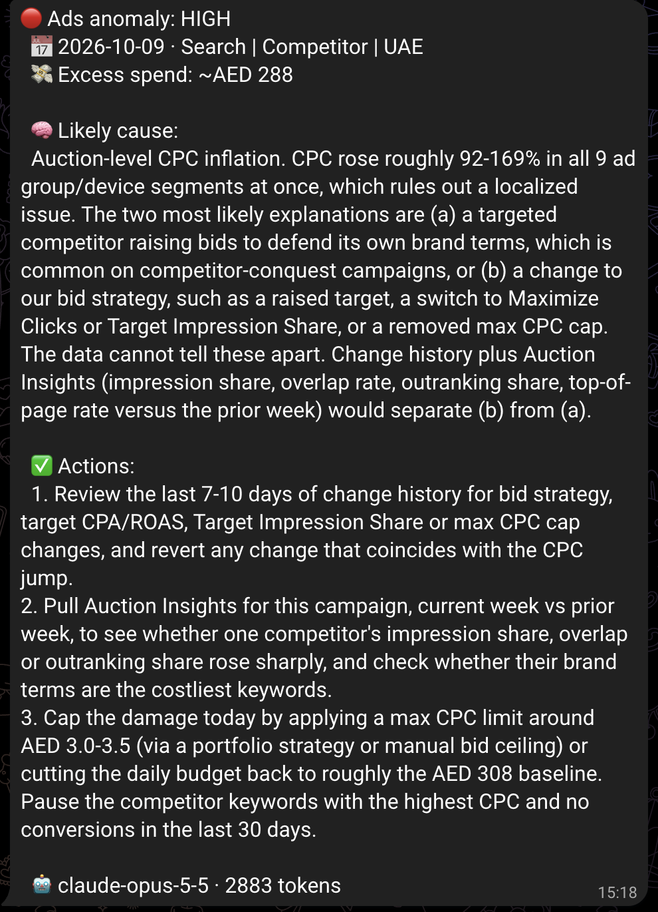
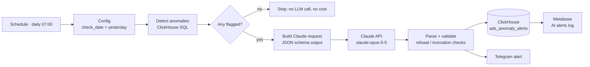
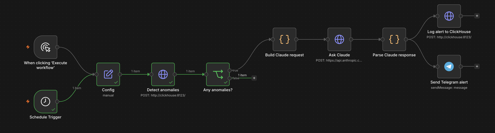

# AI Anomaly Alerts: Google Ads Spend Spikes Explained by Claude

A daily n8n workflow that **detects** Google Ads cost anomalies with SQL in ClickHouse, asks **Claude** to **explain** each one (likely cause, evidence, excess spend, actions), logs the diagnosis to ClickHouse, and sends a **Telegram alert**.

**Design principle:** SQL decides *whether* something is wrong (deterministic and testable); the LLM only explains *why*. Claude never raises or suppresses an alert.

**Backtest:** across **370 days**, the detector caught the planted spike on all 3 days (Oct 8–10) with **0 false alarms**, after adding a marketing-calendar guard that removed 13 false positives during White Friday.

> Builds on the [Marketing Analytics Pipeline](https://github.com/dilrushabdulmajeed-lang/marketing-analytics-pipeline) (Google Ads → ClickHouse → Metabase). The ads data is synthetic; the detection, LLM call, logging and alerting run exactly as they would in production.



## Architecture





## How it works

| Step | Detail |
|---|---|
| **Detect** | For the check date, compares each campaign's spend, CPC and CPA with its trailing 7-day average and flags rises over 40% ([`queries/detect_anomalies.sql`](queries/detect_anomalies.sql)). Only increases count, so recovery after a spike doesn't alert. Divisions are null-guarded, so a day with no data returns nothing instead of crashing. |
| **Context for the LLM** | Each flagged campaign includes a CPC breakdown by ad group × device. A rise across *every* segment points to auction-level pressure; a rise in one segment points to a local issue. Claude uses this distinction in its reasoning. |
| **Suppress planned events** | `analytics.marketing_calendar` lists planned sales; alerts are skipped on those days. |
| **Explain** | One Messages API call with **structured outputs** (`output_config.format: json_schema`), so the response always matches the schema: `severity`, `likely_cause`, `evidence`, `excess_spend_aed`, `recommended_actions`, plus a chat-ready `summary`. Server-side `fallbacks: "default"` retries on another model if a request is declined. See [`n8n/build_claude_request.js`](n8n/build_claude_request.js). |
| **Validate** | Checks `stop_reason` for `refusal` and `max_tokens` before reading content, so failures are loud, never silently logged ([`n8n/parse_claude_response.js`](n8n/parse_claude_response.js)). |
| **Log** | Every alert is stored with model name and token counts in `analytics.ads_anomaly_alerts` (ReplacingMergeTree keyed on date + campaign, so re-runs replace rather than duplicate). |
| **Alert** | A Telegram message per flagged campaign. |

## Example output
Claude's diagnosis for the Oct 9 spike (full JSON in [`docs/sample-alert.json`](docs/sample-alert.json)):

> **Severity: high · Excess spend ~AED 288**
> **Cause:** Auction-level CPC inflation. CPC rose 92–169% in all 9 ad-group/device segments at once, which rules out a localized issue. The likely explanations are a competitor raising bids on its own brand terms, or a change to our bid strategy. *The data cannot tell these apart*: change history plus Auction Insights would.
> **Actions:** review recent bid-strategy changes · pull Auction Insights week over week · cap max CPC around AED 3.0–3.5 until CPA returns to baseline.

Every number in it traces back to the SQL output (CPC 5.37 vs 2.37, CTR flat at 6.95% vs 6.82%), and it states plainly what the data can't show.

## Cost
About **1.3k input + 1.5k output tokens per flagged day, roughly USD 0.035 per alert** on Claude Opus 5.5. Claude is called only on days with an anomaly, so normal days cost nothing. Token counts are logged per alert, and the Metabase card ([`metabase/ai_alerts_log.sql`](metabase/ai_alerts_log.sql)) shows the cost per row.

## Repo structure
```
├── sql/
│   ├── 01_anomaly_alerts_table.sql   # alert log table
│   └── 02_marketing_calendar.sql     # planned events (suppression)
├── queries/
│   └── detect_anomalies.sql          # detection query (parameterized)
├── n8n/
│   ├── build_claude_request.js       # prompt, JSON schema, request body
│   └── parse_claude_response.js      # stop_reason checks + parsing
├── workflows/
│   └── ads-anomaly-alert-ai.json     # import into n8n
├── metabase/ai_alerts_log.sql        # dashboard card
└── docs/                             # sample output, screenshots
```

## Run it
1. Set up the [Marketing Analytics Pipeline](https://github.com/dilrushabdulmajeed-lang/marketing-analytics-pipeline) stack and data (n8n, ClickHouse, Metabase).
2. Create the tables: run `sql/01_*.sql` and `sql/02_*.sql` in ClickHouse.
3. Try the detector on the planted spike:
   `clickhouse-client --param_check_date=2026-10-09 < queries/detect_anomalies.sql`
4. In n8n, import `workflows/ads-anomaly-alert-ai.json` and create credentials:
   - **Basic Auth** for ClickHouse (`n8n_loader` user)
   - **Anthropic** (API key)
   - **Telegram API** (bot token); set your chat ID in the Telegram node
5. Set `Config → check_date` to `2026-10-09` to test, then back to the "yesterday" expression and publish.

## Limitations and next steps
- The baseline is a simple 7-day mean. Weekly seasonality (lower Fri/Sat spend in the UAE) sits below the 40% threshold here, but a same-weekday baseline would be more robust.
- The marketing calendar is maintained by hand. It could be synced from a shared sheet.
- An evaluation set of past incidents with expected causes would let prompt and model changes be scored rather than eyeballed.
